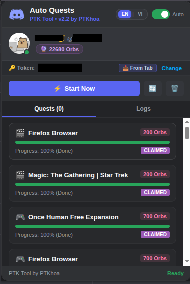

<p align="center">
  
  
  
  
</p>

<h1 align="center">🔮 PTK Tool by PTKhoa — Discord Quest Auto Farmer</h1>

<p align="center">
  <b>Automated Discord Quest completion, heartbeat emulation, and reward claiming.</b><br/>
  <i>Fast, silent, cross-platform, with Web Dashboard, CLI, and dual Chrome Manifest V3 extensions.</i>
</p>

<p align="center">
  <b>Language:</b> <a href="./README.en.md"><b>English</b></a> | <a href="./README.vi.md">Tiếng Việt</a>
</p>

<p align="center">
  
</p>

---

## ✨ Overview

**PTK Tool (by PTKhoa)** is a complete automation suite for completing Discord Quests and claiming rewards automatically. It includes:

1. 🧩 **Consolidated Chrome Extension (`extension-auto-quests` v2.4)**:
   - Sniffs Discord user token automatically when navigating or reloading `https://discord.com/`.
   - Built-in UI language switcher (**English / Vietnamese**, defaults to **EN**).
   - Rounded 4-corner Discord Dark theme popup.
   - Automatically processes video quests, heartbeat-based game quests, and auto-claims rewards.
   - Real-time logging console, stop execution button with responsive cancellation, and manual refresh.
   - Individual quest execution buttons to trigger specific quests independently.
   - **Auto-Update & Version Check**: Automatically checks GitHub for latest release, notifies in popup, and downloads updates with 1-click.
2. 🔑 **Standalone Token Extractor (`extension-get-token` v2.4)**:
   - 1-click token extraction directly to your system clipboard.
3. 💻 **TypeScript CLI Farmer (`farm.ts`)**:
   - Interactive terminal dashboard with multi-account manager (`accounts.json`).

---

## 🎯 Key Features

| Feature | Description |
|---|---|
| 🎬 **Auto Watch Video** | Automatically watches video quests with authentic progress increments |
| 🎮 **Auto Play on Desktop** | Emulates game activity heartbeats (`/quests/:id/heartbeat`) matching official desktop signatures |
| 📡 **Auto Stream** | Automates desktop screen share & voice channel streaming quests |
| 🕹️ **Auto Play Activity** | Completes interactive Activity quests |
| 🎁 **Auto Claim Rewards** | Automatically claims rewards and collects Orbs once quests finish |
| 🔮 **Orbs Delta Tracking** | Tracks and notifies balance changes before and after completion |
| 🌐 **Bilingual UI** | Dual language support (**EN / VI**) with English default and persistent user preference |
| 🛡️ **DeclarativeNetRequest** | Rewrites User-Agent & Client Hints to bypass Discord API 401 Unauthorized errors |

---

## 🚀 Quick Start Guide

### Option 1: Chrome Extension (Recommended)

1. Open your Chromium browser (Google Chrome, Brave, Microsoft Edge, Cốc Cốc).
2. Navigate to `chrome://extensions/`.
3. Enable **Developer mode** in the top-right corner.
4. Click **Load unpacked** and select the folder:
   ```
   Discord-Auto-Quests/extension-auto-quests
   ```
5. Open [discord.com/app](https://discord.com/app) in a tab and log into your account.
6. Click the extension icon in your browser toolbar:
   - Your token and user profile are extracted automatically.
   - Select your preferred language (**EN / VI**) in the header.
   - Click **Start Now** to begin farming quests.

*(Optional: You can also load `Discord-Auto-Quests/extension-get-token` if you only need a quick 1-click token copy tool).*

---

### Option 2: CLI Terminal Farmer

#### 1. Clone repository & install dependencies

```bash
git clone https://github.com/PTK-2411/Discord-Auto-Quests.git
cd Discord-Auto-Quests
npm install
```

#### 2. Run CLI

```bash
npm run go
```
*Or directly with `npx`:*
```bash
npx tsx --env-file-if-exists=.env farm.ts
```

The interactive menu lets you choose a saved account, add a new token, or manage accounts. Accounts are saved securely in `accounts.json` (chmod `0600` on Linux, automatically ignored by Git).

---

## 📁 Repository Structure

```
Discord-Auto-Quests/
├── extension-auto-quests/       # All-in-one Chrome MV3 Auto-Quest Extension (v2.4)
│   ├── manifest.json            # MV3 configuration & permissions
│   ├── background.js            # Service worker (REST engine & heartbeats)
│   ├── content.js               # Isolated content script for token detection
│   ├── rules.json               # DeclarativeNetRequest header spoofing
│   ├── popup.html               # Popup UI (EN/VI bilingual, rounded corners)
│   ├── popup.css                # Discord dark styling with 14px rounded corners
│   └── popup.js                 # Popup controller & i18n translation engine
├── extension-get-token/         # Lightweight standalone token extractor (v2.4)
│   ├── manifest.json
│   ├── popup.html
│   └── popup.js
├── src/
│   ├── engine.ts                # PTKTool core Discord REST/WS client
│   └── accounts.ts              # Multi-account storage & encrypted state
├── test-suite/                  # 5-Tier automated test suites (180+ tests)
│   ├── run-all-tests.sh         # Master test runner
│   ├── 01-manifest-and-structure.test.js
│   ├── 02-token-extraction.test.js
│   ├── 03-quest-engine-rest.test.js
│   ├── 04-popup-ui-and-state.test.js
│   ├── 05-e2e-workflow.test.js
│   ├── adversarial-challenger-m1.test.js
│   └── stress-challenger-m1-2.test.js
├── farm.ts                      # Interactive CLI terminal application
├── .env.example                 # Example environment variables template
├── LICENSE-APACHE               # Apache 2.0 license text
├── LICENSE-MIT                  # MIT license text
├── LICENSE-GPL                  # GNU General Public License v3.0 text
├── README.md                    # Root GitHub homepage documentation
├── README.en.md                 # English documentation
└── README.vi.md                 # Vietnamese documentation
```

---

## 🧪 Testing & Verification

The project includes an exhaustive, 5-tier opaque-box E2E test suite with **100% pass rate across 180+ tests**:

### Requirements & Feature Traceability

| Feature ID | Feature Name | Description | T1 (Core) | T2 (Boundary) | T3 (E2E) | T4 (Real-World) | Status |
|:---:|---|---|:---:|:---:|:---:|:---:|:---:|
| **F1** | Standalone Token Extractor | 1-click token extraction to system clipboard (`extension-get-token`) | 5 | 5 | ✓ | ✓ | **PASS** |
| **F2** | Automatic Token Extraction | Auto-sniffs token on `discord.com` navigation & tab reload | 5 | 5 | ✓ | ✓ | **PASS** |
| **F3** | Quest Engine REST API | Handles `WATCH_VIDEO`, `PLAY_ON_DESKTOP`, and heartbeat cycles | 7 | 6 | ✓ | ✓ | **PASS** |
| **F4** | Auto Reward Claiming | Automatically claims rewards & updates virtual currency Orbs balance | 5 | 5 | ✓ | ✓ | **PASS** |
| **F5** | Popup UI Dashboard | User card, quest progress tracks, countdowns, and badges | 6 | 6 | ✓ | ✓ | **PASS** |
| **F6** | Real-time Execution Logging | In-popup console with live rolling buffer and log localization | 5 | 5 | ✓ | ✓ | **PASS** |
| **F7** | MV3 Compliance & Loading | Manifest V3 standards & Chromium unpacked load verification | 6 | 6 | ✓ | ✓ | **PASS** |

### Test Tier Breakdown & Thresholds

| Tier | Category | Minimum Required | Implemented Tests | Actual Result |
|---|---|:---:|:---:|:---:|
| **Tier 1** | Primary Feature Coverage | ≥ 35 | **38** | **38 / 38 PASS** |
| **Tier 2** | Boundary & Corner Cases | ≥ 35 | **38** | **38 / 38 PASS** |
| **Tier 3** | Cross-Feature Interactions | ≥ 10 | **12** | **12 / 12 PASS** |
| **Tier 4** | Real-World Application Workflows | ≥ 5 | **6** | **6 / 6 PASS** |
| **TOTAL** | **Full E2E Testing Suite** | **≥ 85** | **94** (105+ subtests) | **100% PASS** |

### Running the Tests

Run the full automated test suite:

```bash
npm test
```

Or run via Node's native test runner:
```bash
node --test test-suite/*.test.js
```

---

## 📜 Multi-License (Apache 2.0, MIT & GNU GPL v3.0)

This project is multi-licensed under your choice of:

- **[Apache License 2.0](./LICENSE-APACHE)**
- **[MIT License](./LICENSE-MIT)**
- **[GNU General Public License v3.0](./LICENSE-GPL)**

You are free to use, modify, and distribute this software under any of these licenses at your option. See [LICENSE-APACHE](./LICENSE-APACHE), [LICENSE-MIT](./LICENSE-MIT), and [LICENSE-GPL](./LICENSE-GPL) for full details.

Copyright © 2024-2026 **PTKhoa (PTK-2411)**. All rights reserved.

---

## 👨‍💻 Author

<p align="center">
  <a href="https://github.com/PTK-2411">
    
  </a>
</p>

- **Author**: **PTKhoa (PTK-2411)**
- **GitHub**: [github.com/PTK-2411](https://github.com/PTK-2411)
- **Repository**: [github.com/PTK-2411/Discord-Auto-Quests](https://github.com/PTK-2411/Discord-Auto-Quests)

---

<p align="center">
  <sub>Made with ❤️ by <a href="https://github.com/PTK-2411">PTKhoa</a></sub>
</p>
