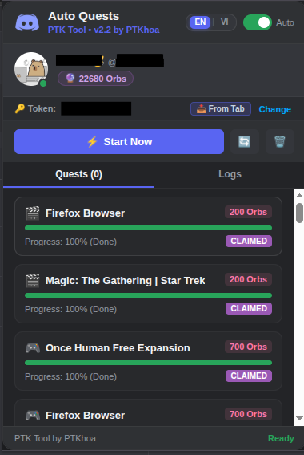

<p align="center">
  
  
  
  
</p>

<h1 align="center">🔮 PTK Tool by PTKhoa — Discord Quest Auto Farmer</h1>

<p align="center">
  <b>Bộ công cụ tự động làm nhiệm vụ Discord, giả lập heartbeat và tự động nhận thưởng.</b><br/>
  <i>Nhanh chóng, êm ái, đa nền tảng với Web Dashboard, CLI và 2 tiện ích mở rộng Chrome Manifest V3.</i>
</p>

<p align="center">
  <b>Ngôn ngữ:</b> <a href="./README.vi.md"><b>Tiếng Việt</b></a> | <a href="./README.en.md">English</a>
</p>

<p align="center">
  
</p>

---

## ✨ Giới thiệu

**PTK Tool (phát triển bởi PTKhoa)** là một hệ sinh thái tự động hóa toàn diện giúp bạn hoàn thành các nhiệm vụ Discord Quests và nhận thưởng tự động. Dự án bao gồm:

1. 🧩 **Tiện ích mở rộng Chrome tổng hợp (`extension-auto-quests` v2.4.1)**:
   - Tự động bắt token Discord ngầm khi mở hoặc tải lại tab `https://discord.com/`.
   - Hỗ trợ chuyển đổi song ngữ (**Tiếng Việt / Tiếng Anh**, mặc định là **English**).
   - Giao diện Popup bo tròn 4 góc 14px chuẩn Discord Dark theme.
   - Tự động xử lý nhiệm vụ xem video, nhiệm vụ chơi game qua heartbeat và tự nhận thưởng.
   - Console ghi nhật ký thời gian thực, nút dừng phản hồi ngay lập tức và nút làm mới dữ liệu tức thì.
   - Nút làm nhiệm vụ lẻ cho từng nhiệm vụ riêng biệt.
   - **Sao chép Token nhanh**: Nút sao chép token (`btnCopyToken`) đưa token Discord đang kích hoạt vào bộ nhớ tạm (clipboard) chỉ với 1 click.
   - **Tự động kiểm tra bản cập nhật**: Tự động so sánh phiên bản từ GitHub, hiện thông báo trên Popup và tải bản cập nhật trực tiếp chỉ với 1 click.
2. 🔑 **Tiện ích trích xuất Token độc lập (`extension-get-token` v2.4.1)**:
   - Trích xuất token Discord vào Clipboard chỉ với 1 cú click.
3. 💻 **Ứng dụng dòng lệnh CLI TypeScript (`farm.ts`)**:
   - Giao diện dashboard terminal đa tài khoản (`accounts.json`).

---

## 🎯 Tính năng nổi bật

| Tính năng | Mô tả chi tiết |
|---|---|
| 🎬 **Auto Watch Video** | Tự động xem video quest với tiến trình thời gian giả lập chuẩn xác |
| 🎮 **Auto Play on Desktop** | Giả lập heartbeat (`/quests/:id/heartbeat`) với chữ ký Desktop Client chính thức |
| 📡 **Auto Stream** | Hỗ trợ tự động các nhiệm vụ phát trực tiếp (stream) trên Discord |
| 🕹️ **Auto Play Activity** | Hỗ trợ các nhiệm vụ chơi Discord Activity |
| 🎁 **Auto Claim Rewards** | Tự động bấm nhận thưởng và thu thập Orb ngay khi hoàn thành quest |
| 🔮 **Theo dõi biến động Orb** | Hiển thị và thông báo số dư Orb trước và sau khi cày nhiệm vụ |
| 🌐 **Giao diện song ngữ** | Chuyển đổi mượt mà giữa **EN / VI**, lưu trạng thái vào bộ nhớ cục bộ |
| 🛡️ **DeclarativeNetRequest** | Viết lại header `User-Agent` & Client Hints để vượt qua lỗi 401 Unauthorized của Discord |

---

## 🚀 Hướng dẫn cài đặt & sử dụng

### Lựa chọn 1: Tiện ích mở rộng Chrome (Khuyên dùng)

1. Mở trình duyệt Chromium (Google Chrome, Brave, Microsoft Edge, Cốc Cốc).
2. Truy cập vào `chrome://extensions/`.
3. Bật **Chế độ dành cho nhà phát triển (Developer mode)** ở góc trên bên phải.
4. Nhấn nút **Tải tiện ích đã giải nén (Load unpacked)** và chọn thư mục:
   ```
   Discord-Auto-Quests/extension-auto-quests
   ```
5. Mở tab [discord.com/app](https://discord.com/app) và đăng nhập tài khoản.
6. Bấm vào biểu tượng extension trên thanh công cụ:
   - Token và thông tin tài khoản sẽ tự động được nhận diện.
   - Chọn ngôn ngữ ưa thích (**EN / VI**) ở góc trên bên phải.
   - Nhấn **Start Now** (hoặc **Chạy ngay**) để bắt đầu cày nhiệm vụ tự động.

*(Nếu chỉ muốn copy token nhanh vào clipboard, bạn có thể load thư mục `Discord-Auto-Quests/extension-get-token`).*

---

### Lựa chọn 2: Ứng dụng dòng lệnh CLI

#### 1. Tải source code & cài đặt thư viện

```bash
git clone https://github.com/PTK-2411/Discord-Auto-Quests.git
cd Discord-Auto-Quests
npm install
```

#### 2. Khởi chạy CLI

```bash
npm run go
```
*Hoặc chạy trực tiếp với `npx`:*
```bash
npx tsx --env-file-if-exists=.env farm.ts
```

Menu tương tác cho phép bạn chọn tài khoản đã lưu, dán token mới hoặc quản lý danh sách tài khoản. Thông tin tài khoản được lưu an toàn tại `accounts.json` (phân quyền `0600` trên Linux và đã được cấu hình trong `.gitignore`).

---

## 📁 Cấu trúc thư mục

```
Discord-Auto-Quests/
├── extension-auto-quests/       # Tiện ích Chrome MV3 tự động làm quest (v2.4.1)
│   ├── manifest.json            # Cấu hình MV3 & quyền hạn
│   ├── background.js            # Service worker (REST engine & heartbeats)
│   ├── content.js               # Content script trích xuất token tự động
│   ├── rules.json               # Cấu hình declarativeNetRequest giả lập header
│   ├── popup.html               # Giao diện Popup song ngữ (bo tròn 4 góc)
│   ├── popup.css                # CSS Discord Dark theme bo tròn 14px
│   └── popup.js                 # Điều khiển Popup & bộ máy i18n
├── extension-get-token/         # Tiện ích độc lập lấy token vào clipboard (v2.4.1)
│   ├── manifest.json
│   ├── popup.html
│   └── popup.js
├── src/
│   ├── engine.ts                # PTKTool core Discord REST/WS client
│   └── accounts.ts              # Quản lý tài khoản & lưu trữ cục bộ
├── test-suite/                  # Bộ kiểm thử tự động 5 tầng (hơn 180 tests)
│   ├── run-all-tests.sh         # Script chạy toàn bộ test
│   ├── 01-manifest-and-structure.test.js
│   ├── 02-token-extraction.test.js
│   ├── 03-quest-engine-rest.test.js
│   ├── 04-popup-ui-and-state.test.js
│   ├── 05-e2e-workflow.test.js
│   ├── adversarial-challenger-m1.test.js
│   └── stress-challenger-m1-2.test.js
├── farm.ts                      # Ứng dụng dòng lệnh CLI
├── .env.example                 # Mẫu biến môi trường an toàn
├── LICENSE-APACHE               # Toàn văn giấy phép Apache 2.0
├── LICENSE-MIT                  # Toàn văn giấy phép MIT
├── LICENSE-GPL                  # Toàn văn giấy phép GNU General Public License v3.0
├── README.md                    # Tài liệu chính hiển thị trang chủ GitHub
├── README.vi.md                 # Tài liệu Tiếng Việt (Tệp này)
└── README.en.md                 # Tài liệu Tiếng Anh
```

---

## 🧪 Kiểm thử tự động (Testing & Verification)

Dự án đi kèm bộ kiểm thử E2E 5 tầng toàn diện đạt **tỷ lệ vượt qua 100% với hơn 180+ tests**:

### Bảng đối chiếu tính năng & yêu cầu kỹ thuật

| Mã tính năng | Tên tính năng | Mô tả chi tiết | T1 (Cốt lõi) | T2 (Biên) | T3 (E2E) | T4 (Thực tế) | Trạng thái |
|:---:|---|---|:---:|:---:|:---:|:---:|:---:|
| **F1** | Trích xuất Token độc lập | Copy token vào Clipboard với 1 cú click (`extension-get-token`) | 5 | 5 | ✓ | ✓ | **PASS** |
| **F2** | Tự động bắt Token | Tự động phát hiện token khi người dùng mở `discord.com` | 5 | 5 | ✓ | ✓ | **PASS** |
| **F3** | Quest Engine REST API | Xử lý `WATCH_VIDEO`, `PLAY_ON_DESKTOP` và chu kỳ heartbeat | 7 | 6 | ✓ | ✓ | **PASS** |
| **F4** | Tự động nhận thưởng | Tự động nhận thưởng & cập nhật số dư Orb vào ví | 5 | 5 | ✓ | ✓ | **PASS** |
| **F5** | Giao diện Popup Dashboard | Thẻ người dùng, thanh tiến trình quest, đếm ngược và huy hiệu | 6 | 6 | ✓ | ✓ | **PASS** |
| **F6** | Nhật ký thực thi thời gian thực | Console trong popup với bộ nhớ đệm cuộn và chuyển đổi ngôn ngữ | 5 | 5 | ✓ | ✓ | **PASS** |
| **F7** | Chuẩn Manifest V3 & Tải Chromium | Tuân thủ Manifest V3 & kiểm tra tải unpacked trên Chromium thật | 6 | 6 | ✓ | ✓ | **PASS** |

### Phân bổ các tầng kiểm thử & Mức đạt được

| Tầng kiểm thử | Danh mục | Yêu cầu tối thiểu | Số lượng test đã tạo | Kết quả thực tế |
|---|---|:---:|:---:|:---:|
| **Tier 1** | Độ phủ tính năng chính | ≥ 35 | **38** | **38 / 38 PASS** |
| **Tier 2** | Các trường hợp biên & ngoại lệ | ≥ 35 | **38** | **38 / 38 PASS** |
| **Tier 3** | Tương tác chéo giữa các module | ≥ 10 | **12** | **12 / 12 PASS** |
| **Tier 4** | Kịch bản luồng công việc thực tế | ≥ 5 | **6** | **6 / 6 PASS** |
| **TỔNG CỘNG** | **Toàn bộ bộ kiểm thử E2E** | **≥ 85** | **94** (105+ subtests) | **100% PASS** |

### Lệnh chạy kiểm thử

Chạy toàn bộ bộ test tự động:

```bash
npm test
```

Hoặc chạy trực tiếp qua bộ chạy test tích hợp của Node.js:
```bash
node --test test-suite/*.test.js
```

---

## 📜 Đa giấy phép (Multi-License: Apache 2.0, MIT & GNU GPL v3.0)

Dự án này được cấp phép đa giấy phép (**Multi-License**):

- **[Apache License 2.0](./LICENSE-APACHE)**
- **[MIT License](./LICENSE-MIT)**
- **[GNU General Public License v3.0](./LICENSE-GPL)**

Bạn có quyền tự do lựa chọn sử dụng, sửa đổi và phân phối mã nguồn theo một trong các giấy phép trên tùy nhu cầu. Chi tiết xem tại [LICENSE-APACHE](./LICENSE-APACHE), [LICENSE-MIT](./LICENSE-MIT) và [LICENSE-GPL](./LICENSE-GPL).

Copyright © 2024-2026 **PTKhoa (PTK-2411)**. All rights reserved.

---

## 👨‍💻 Tác giả

<p align="center">
  <a href="https://github.com/PTK-2411">
    
  </a>
</p>

- **Tác giả**: **PTKhoa (PTK-2411)**
- **GitHub**: [github.com/PTK-2411](https://github.com/PTK-2411)
- **Repository**: [github.com/PTK-2411/Discord-Auto-Quests](https://github.com/PTK-2411/Discord-Auto-Quests)

---

<p align="center">
  <sub>Made with ❤️ by <a href="https://github.com/PTK-2411">PTKhoa</a></sub>
</p>
